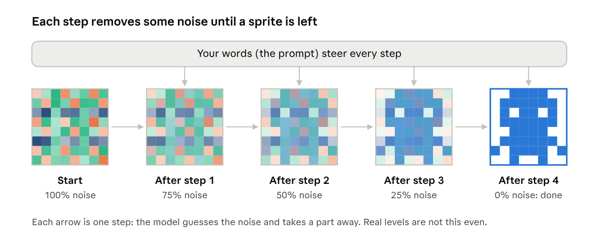
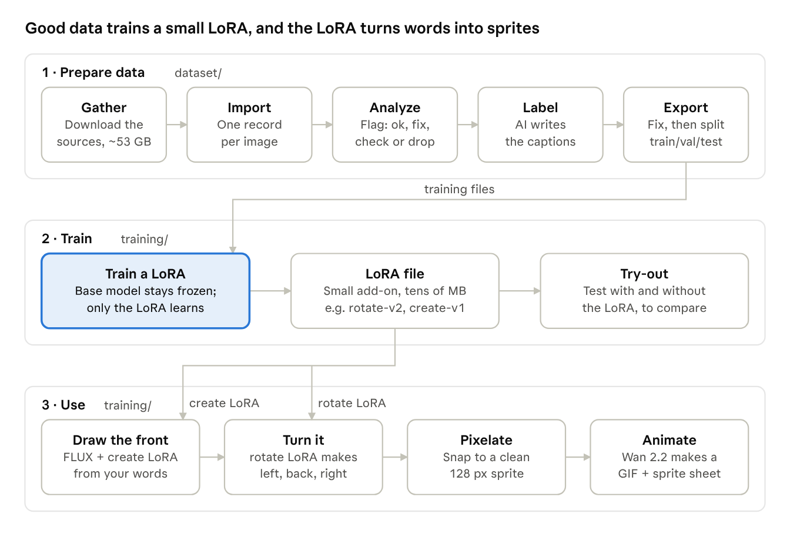

# Pixel AI Engine — Beginner Guide

A short guide for people new to AI training. The live copy is a Claude Doc:
https://claude.ai/artifact/WnF3sK6Q8jnVo7g93szvu5

## What it is

The Pixel AI Engine makes pixel-art game characters on your own Mac, with no internet once the models are downloaded. It does four jobs:

| Job | In | Out | Status |
| --- | --- | --- | --- |
| Create | text ("a frog wizard") | a front-view character | works (create LoRA) |
| Rotate | one front view | left, back, right views | works (rotate LoRA) |
| Animate | a character + an action | a GIF and a sprite sheet | try-out (Wan 2.2) |
| Landscape | text | a background | later |

We do not build a model from zero. We take a big existing image model and teach it a small new skill with our own data.

## Key words

Learn these first. Every other part of this guide uses them.

**Data**

| Word | Meaning | In this project |
| --- | --- | --- |
| Dataset | A big set of examples the model learns from. | ~53 GB of pixel sprites from sources like `pac` and `lpc-4view`. |
| Record | One row that describes one image: character, view, size, source, licence. | Stored in `data/records.sqlite`. It points at the image, it does not copy it. |
| View | The way the character faces. | `front`, `back`, `left`, `right` (+ 4 diagonals for 8-direction). |
| Caption / label | Words that describe an image. The model learns "these words → this picture". | LPC has exact captions. `pac` got labels written by Haiku 5.5. |
| Export | A clean, fixed copy of the data, ready for training. | `data/exports/rotation-v1-data/` |
| Train / val / test split | Train = what the model learns from (90%). Val = checked during training (5%). Test = only used at the end (5%). | Split by character group. |
| Leak | When the same character is in train and test. Then the test score lies. | The export checks for leaks. |

**Model**

| Word | Meaning | In this project |
| --- | --- | --- |
| Model | A big file of numbers (weights) that turns input into output. | FLUX.2 Klein 4B (images), Wan 2.2 (video). |
| Weights / parameters | The numbers inside a model. Training changes them. "4B" = 4 billion numbers. | |
| Diffusion model | Makes a picture by starting from random noise and removing noise step by step. | FLUX is a diffusion model. |
| Prompt | The text you give the model. | `prompts.json` holds our prompt templates. |
| Seed | A number that fixes the random noise. Same seed + same prompt = same picture. | `--seeds 4` makes 4 versions. |
| Sampling steps | How many noise-removal passes. More steps = slower, often sharper. | Klein 4B: 4 steps. Klein Base: 28 steps. |
| Base vs distilled | Base = the original model, good to train. Distilled = a sped-up copy, fast but bad to train. | We train on Base, draw fronts with the 4-step one. |
| Text encoder | The part that turns your words into numbers. | ~8 GB. |
| VAE | The part that packs a picture small for the model, and unpacks it again. | |
| Inference | Using a model to make output. No learning happens. | `generate`, `animate`, `tryout`. |
| Quantized (4-bit, GGUF) | The weights stored with fewer bits so the model uses less memory. A little less exact. | Wan 2.2 runs as 4-bit GGUF to fit in 32 GB. |
| Hugging Face | The website where models are shared and downloaded. | `uv run hf download …` |

**Training**

| Word | Meaning | In this project |
| --- | --- | --- |
| Training | Showing the model examples and nudging its weights to be less wrong. | `pixel-train train` |
| Fine-tuning | Training an existing model a little more for a new skill. | All our training is fine-tuning. |
| LoRA | A small add-on file of extra weights. The big model stays frozen; only the LoRA learns. Small (tens of MB) and fits on a Mac. | `rotate-v2`, `create-v1` |
| Step | One small learning update on a few examples. | `--steps 2000` |
| Loss | A number for "how wrong". Lower is better. | Logged in `log.jsonl`, shown as a chart. |
| Checkpoint | A saved copy of the LoRA at one step. You can go back to it or resume from it. | `checkpoints/step-000500/` |
| Overfitting | The model remembers the training data but fails on new data. Val loss going up shows it. | Why we keep val and test apart. |
| Try-out | Run a model on fixed test inputs to compare results. | `pixel-train tryout` |

## Inside the model: diffusion and LoRA

Diffusion makes a picture by removing noise, step by step. A LoRA is a small patch that changes how the big model does that, without touching the big model.

### Diffusion

The model learned one skill: look at a noisy picture and say which way the noise goes.

1. **Start with noise.** The seed picks a field of random noise. Same seed = same noise = same picture.
2. **Read the prompt.** The text encoder turns your words into numbers. The model reads them at every step.
3. **Remove a bit of noise.** Each step, the model guesses the noise and takes a part of it away.
4. **Repeat.** After 4 steps (Klein 4B) or 28 steps (Klein Base), a clean picture is left.
5. **Unpack.** The model works on a small packed copy (a "latent"). The VAE unpacks it into a real picture.



The model draws soft, smooth colours. That is why `pixelate.py` snaps the result to a grid with few colours.

**How it is trained** (`lora.py`, `loss()`): take a real sprite, mix it with random noise at a random level, and ask the model for the direction from the picture to the noise. The loss is how far its answer is from the true direction. This method is called *flow matching*; FLUX was trained the same way.

### LoRA

A model layer is a big table of numbers, called W. Training all of W needs too much memory for a Mac. A LoRA keeps W frozen and adds two thin tables, A and B, next to it:

```
W_new = W + B · A
```

| | Full fine-tune | LoRA, rank 16 |
| --- | --- | --- |
| Numbers that learn, for one 3072 × 3072 layer (example size) | 9.4 million | 98 thousand (about 1%) |
| Saved file | the whole model, GBs | tens of MB |
| Fits on a 32 GB Mac | no | yes |

- **Rank** = how thin A and B are. Ours is 16 (`--rank`). Higher rank learns more but uses more memory.
- **Swap it:** take the LoRA off and the original model is back. We use two: the create LoRA to draw, the rotate LoRA to turn.
- **Where it sits:** on the attention layers of the FLUX transformer (the `TARGETS` list in `lora.py`).

## How it works

It runs in three stages, top to bottom.



1. **Prepare data.** Download sprites, make one record per image, remove bad images, add captions, and write clean training files.
2. **Train.** Show the model thousands of examples. Only the small LoRA changes. The loss (how wrong it is) goes down. Then compare against the plain model.
3. **Use.** Your words go to FLUX with the create LoRA to draw the front. The rotate LoRA turns it. A pixelate step snaps the soft AI picture to a clean sprite. Wan 2.2 animates it.

## Project map

The repo has two parts: `dataset/` prepares the data, `training/` trains and runs the models. An `engine/` folder comes later.

| Path | What it does |
| --- | --- |
| `dataset/sources.json` | Every data source: where it comes from, exact version, licence. |
| `dataset/src/pixel_data/gather/` | Downloads sources and turns them into records. |
| `dataset/src/pixel_data/analyze/` | Measures each image and flags bad ones (rules in `rules.py`). |
| `dataset/src/pixel_data/export/` | Fixes, splits and writes the training files. |
| `dataset/src/pixel_data/dashboard/` | The downloads page, and the reads and job checks the dashboard uses. |
| `server/`, `ui/` | The dashboard: its API (FastAPI) and its screens (React). |
| `dataset/labelling/` | Tools to label images with an AI (Haiku 5.5). |
| `training/prompts.json` | The prompt templates for create and rotate. |
| `training/src/pixel_training/train.py` | The training loop. |
| `training/src/pixel_training/lora.py` | The LoRA add-on. |
| `training/src/pixel_training/generate.py` | Text → character in 4 views. |
| `training/src/pixel_training/animate.py` | Character → animation with Wan 2.2. |
| `training/src/pixel_training/pixelate.py` | Snaps a soft AI picture to a clean sprite. |
| `dataset/data/` | All data and results (not in git): `raw/`, `exports/`, `runs/`, `generated/`, `animated/`. |

Each image gets a status after `pixel analyze`: **ok** (ready), **fix** (auto-repaired), **check** (a person should look), **drop** (left out).

## How to run it

Run these on a 32 GB Mac. One big job at a time: each one fills most of the memory.

1. Set up once:

   ```bash
   brew install uv
   cd dataset && uv sync
   cd ../training && uv sync --extra models && uv run hf auth login
   ```
2. Prepare the data (from `dataset/`):

   ```bash
   uv run pixel gather pac lpc-4view
   uv run pixel import pac lpc-4view
   uv run pixel analyze
   uv run pixel export
   ```
3. Look at everything in the dashboard. Build it once, then start it and open http://127.0.0.1:8780:

   ```bash
   cd ../ui && npm install && npm run build
   cd ../server && uv run pixel-server
   ```
4. Train a LoRA (from `training/`):

   ```bash
   uv run pixel-train train --name rotate-v1
   uv run pixel-train train --task create --name create-v1 --size 256 --steps 2000 --sources lpc-4view
   ```
5. Make a character in 4 views:

   ```bash
   uv run pixel-train generate "a frog wizard" --create-lora ../dataset/data/runs/create-v1 --lora ../dataset/data/runs/rotate-v2
   ```
6. Animate it:

   ```bash
   uv run pixel-train animate knight --views right --actions walk
   ```

You can also start steps 4–6 from the Training, Create, Rotate and Animate screens of the dashboard. Add `HF_HUB_OFFLINE=1` before a command to stay offline. Licence note: `pac` is non-commercial, so only a LoRA trained on `lpc-4view` alone can go into a game you sell.

## What to learn next

Learn by doing, in this order. Each step uses this project.

- [ ] Open the dashboard's Library and look at the records, the flagged images and the export. This shows what "good data" means.
- [ ] Read `analyze/rules.py`. See why an image is ok, fix, check or drop.
- [ ] Run a small try-out: `uv run pixel-train tryout --seeds 1 --rotate 2`. Compare the model before any training.
- [ ] Run a short training: `uv run pixel-train train --name first --steps 20 --every 10`. Watch the loss go down.
- [ ] Try a checkpoint with `tryout --lora …` and compare it to the plain model. This is how you know training helped.
- [ ] Read `train.py` and `lora.py` slowly. Find where the loss is computed and where the LoRA weights change.
- [ ] Read the labelling results in `dataset/labelling/README.md`. It shows how label errors (14.5%) become model errors.
